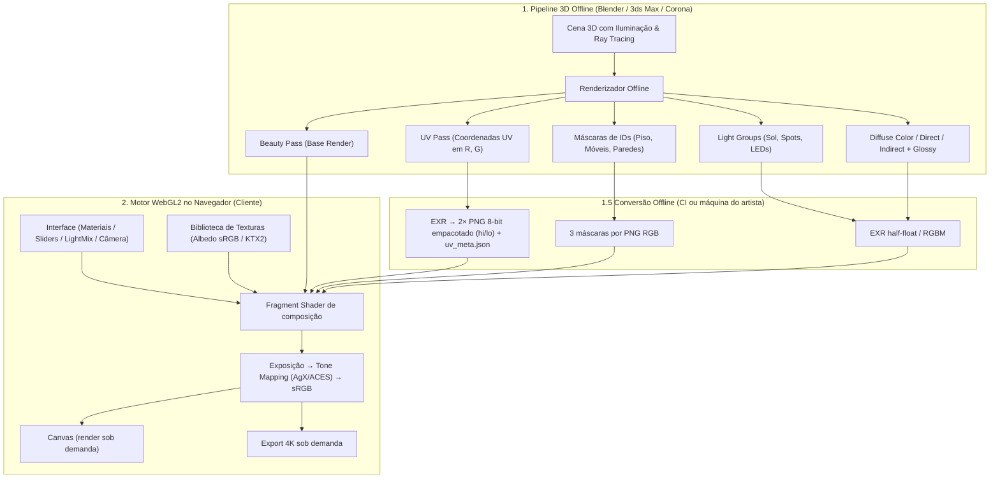

# Engenharia Reversa & Guia de Replicação: Zytro / ZYcompose

**Versão unificada (v3)**: junta o guia original, a rev. 2 e a versão melhorada v2 num único documento. Os trechos repetidos foram mesclados, a numeração foi refeita e corrigi pequenos erros (ver Histórico no final). Nenhuma informação técnica foi descartada.

Este documento descreve a arquitetura técnica, o pipeline 3D e a implementação web do **ZYcompose (Zytro)**. É um configurador fotorrealista para navegador que funciona compondo imagens 2.5D e passes de renderização (AOVs), sem usar 3D pesado nem streaming em nuvem.

> **Nota:** a arquitetura abaixo é *inferida* a partir do comportamento observado do produto: troca instantânea de materiais com perspectiva correta, sombras preservadas e export rápido. O objetivo é replicar a **técnica**, não copiar código, assets ou marca do Zytro.

### Como usar este guia

- **Pipeline completo:** leia os Capítulos 1 a 7 na ordem.
- **Artista 3D:** foque nos Capítulos 2 e 5, e no 11 (QA).
- **Dev front-end/WebGL:** foque nos Capítulos 3, 4, 8 e 10.
- **PM/tech lead:** Capítulo 1 (com o comparativo), Capítulo 7 (Roadmap, Fases 0–6) e Capítulo 13 (Pontos de atenção).
- **Nunca fez nada disso:** comece pelo **Apêndice A — Primeiros passos**.

### Sumário

1. Visão Geral da Arquitetura
2. Pipeline de Produção 3D (Passes & AOVs)
3. O Segredo Técnico: o UV Pass (ST Map)
4. Shaders e Motor WebGL (Three.js)
5. Exportação dos Passes no Blender
6. Estrutura de Dados do Catálogo (JSON)
7. Roadmap de Implementação (Fases 0–6)
8. Performance e Orçamento de Memória
9. Limitações da Técnica
10. Troubleshooting e Depuração
11. Checklist de QA
12. Tabelas de Referência Rápida
13. Pontos de Atenção Finais
14. Glossário
- Apêndice A — Primeiros passos práticos
- Histórico de versões

---

## 1. Visão Geral da Arquitetura

O ZYcompose não carrega geometria 3D poligonal no navegador e não usa Pixel Streaming na nuvem (Unreal Engine em instâncias AWS EC2). Ele usa uma técnica conhecida em efeitos visuais como **Deep/2.5D Image Compositing com Re-projeção UV via Shaders**.

### 1.1 Diagrama do fluxo



Mesmo fluxo em texto, para quando o Mermaid não renderizar:

```text
[1] OFFLINE 3D (Blender/Cycles, 3ds Max/Corona)
    Cena + luzes + materiais
      |--> Beauty (Combined)
      |--> UV (EXR) + Diffuse Direct/Indirect/Color + Glossy + Light Groups
      |--> Máscaras (Cryptomatte / Object Index)
[1.5] CONVERSÃO OFFLINE (CI ou máquina do artista)
      |--> pack_uv.py: EXR -> cam1_uv_hi.png + cam1_uv_lo.png + uv_meta.json (uv_range)
      |--> Luz HDR: EXR half-float (PIZ/ZIP) ou RGBM em PNG
      |--> Máscaras: 3 slots por PNG RGB
              |  (upload para CDN/S3 como arquivos estáticos)
              v
[2] NAVEGADOR (WebGL2 + Three.js)
    UI (material + sliders + LightMix + câmera)
      + Biblioteca (albedo sRGB / KTX2) + passes da etapa [1.5]
              |
              v
    Shader de produção (decode hi/lo -> R(θ)·(uv·S)+O -> textureGrad
      -> albedo×diffLight + glossy -> LightMix ratio -> tone map AgX/ACES -> sRGB)
              |---> Canvas (render sob demanda, não loop 60 FPS)
              |---> Export 4K sob demanda (passes 4K + readRenderTargetPixels + toBlob)
```

### 1.2 Por que essa abordagem é adotada comercialmente?

1. **Fidelidade cinematográfica:** o cliente vê a iluminação global fotorrealista calculada por motores offline (Corona, V-Ray, Cycles).
2. **Custo de infraestrutura mínimo:** os assets são imagens estáticas servidas via CDN (Cloudflare/AWS S3). Não há gasto com servidores GPU por minuto.
3. **Compatibilidade universal:** roda em smartphones e computadores básicos sem superaquecer a bateria e sem exigir WebGPU.
4. **Previsibilidade:** o resultado é idêntico em todos os dispositivos, porque o "render" já foi feito. O que o time de arte aprova é exatamente o que o cliente vê, sem diferenças de LOD, sombras em tempo real ou drivers de GPU.
5. **Escala de catálogo:** um material novo não exige re-renderizar a cena. Basta subir uma textura e uma linha no JSON.

> **Ressalva realista:** os "60 FPS em qualquer smartphone" valem para a *composição*, que é só um quad em tela cheia com poucas leituras de textura. Em celulares, o gargalo real é **memória de GPU e tempo de download** dos passes, não o shader (Capítulo 8).

### 1.3 Comparativo com as alternativas

| Abordagem | Qualidade de luz | Liberdade de câmera | Custo por usuário | Peso inicial |
| :--- | :--- | :--- | :--- | :--- |
| **2.5D + AOVs (esta)** | Offline (GI completa) | Apenas câmeras pré-renderizadas | ~zero (CDN) | 5–30 MB por câmera |
| 3D em tempo real (Three.js/Babylon) | Lightmaps + PBR, inferior | Livre | ~zero | 20–150 MB |
| Pixel Streaming (Unreal) | Alta (Lumen) | Livre | Alto (GPU por minuto) | Baixo, mas exige banda estável |
| Pré-render de todas as combinações | Máxima | Apenas câmeras fixas | ~zero | Explode combinatoriamente (N materiais × M slots) |

### 1.4 O que o usuário vê vs. o que o sistema faz

| Ação do usuário | O que acontece por baixo | Arquivos envolvidos |
| :--- | :--- | :--- |
| Clica em "Carvalho Natural" no piso | O shader decodifica o UV hi/lo, aplica `R(θ)·(uv·S)+O` e calcula `albedo × diffLight + glossy × gloss_keep`, só onde `masks.r = 1` | `cam1_uv_hi/lo.png`, `cam1_diff_light.exr`, `cam1_glossy.exr`, `cam1_masks_a.png`, `wood_oak_diffuse.webp` |
| Arrasta "Escala" (porcelanato 1,20 m) | `u_tiling = 1/1.2 = 0.833`, com UV em metros (sem número mágico) | Só uniforms; `texture_size_m: [1.2, 1.2]` veio do JSON |
| Arrasta "Sol" de 1.0 para 1.4 | Recalcula `mixed = Σ I·RGB(T)·G` e aplica `ratio = mixed/beauty` ao material novo | `cam1_lg_sun.exr`, `cam1_lg_leds.exr`, conversão Kelvin→RGB no JS |
| Clica em "Baixar 4K" | Carrega os passes 4K sob demanda → `WebGLRenderTarget` 3840×2160 → `readRenderTargetPixels` → canvas 2D → `toBlob()` → `dispose()` | `assets/renders/4k/cam1_*` (prefixo `export_passes_prefix`) |

### 1.5 Limites da arquitetura (visão rápida)

1. **Câmera fixa por render.** Contorno: várias câmeras, ou panoramas 360° equirretangulares com o mesmo princípio.
2. **Geometria não muda sem re-render.** Contorno: pré-renderizar cada variante de modelo como camada própria (beauty + passes + alfa).
3. **Reflexos e rugosidade vêm "assados".** Contorno: `gloss_keep` por material e 2–3 variações de glossy (fosco/acetinado/polido). Com materiais foscos o problema quase desaparece.
4. **Gargalo é download + memória de GPU.** Planeje 1080p–1440p na visualização e 4K só no export.

Detalhes no Capítulo 9.

---

## 2. Pipeline de Produção 3D (Passes & AOVs)

Para cada câmera do projeto, o software 3D exporta uma coleção de camadas (AOVs, *Arbitrary Output Variables*).

### 2.1 Passes básicos

| Passe | Descrição | Formato recomendado | Função no navegador |
| :--- | :--- | :--- | :--- |
| **Beauty / Combined** | Imagem final com a iluminação combinada. | WebP q85–92 para exibição + EXR linear se o tone mapping for unificado | Camada visual de fundo. |
| **UV Pass (ST Map)** | Coordenadas $U$ e $V$ nos canais **Vermelho (R)** e **Verde (G)**. | EXR no render → 2× PNG 8-bit hi/lo para a web (Seção 3.2) | Permite ao shader mapear texturas novas com a perspectiva exata. |
| **Material/Object IDs** | Máscara isolando cada objeto configurável (piso, armários, bancada). | PNG 8-bit lossless, até 3 máscaras por arquivo (R/G/B) | Delimita onde a textura nova é aplicada, sem vazar. |
| **Ambient Occlusion & Sombras** | Sombras de contato e oclusão de ambiente. | WebP em escala de cinza | Modo simplificado/fallback quando não há passes de luz. |
| **Light Groups (LightMix)** | A cena iluminada por uma única fonte ou grupo (só Sol, só LED). | EXR half-float ou RGBM | Controle de intensidade e temperatura de cor de cada luz. |

> **Atenção ao "PNG 16-bit":** navegadores decodificam PNG 16-bit para **8 bits por canal** ao carregar via ``, `ImageBitmap` ou `TextureLoader`. O arquivo tem 16 bits no disco, mas chega ao shader com só 256 níveis, e isso gera "degraus" visíveis na textura. A solução é **empacotar** os 16 bits em dois PNGs 8-bit (Seção 3.2) ou carregar EXR via `EXRLoader`.

### 2.2 Passes de iluminação separados (o que dá o fotorrealismo de verdade)

Multiplicar a textura nova só por AO/sombras (como no shader conceitual da Seção 4.1) perde a iluminação global. O piso novo fica "chapado", sem o gradiente da janela, sem *color bleeding* e sem reflexos. O certo é **separar o beauty em luz × cor**:

$$\text{Beauty} = C_{diff}\,(L^{dir}_{diff} + L^{ind}_{diff}) + C_{gloss}\,(L^{dir}_{gloss} + L^{ind}_{gloss}) + C_{trans}\,(L^{dir}_{trans} + L^{ind}_{trans}) + \text{Emit} + \text{Env}$$

Para trocar um material, substitua $C_{diff}$ (a cor/albedo original) pelo albedo da textura nova e mantenha a luz $L_{diff}$ calculada pelo renderizador:

$$\text{Novo} = \text{Albedo}_{novo} \cdot L_{diff} + k_{gloss} \cdot C_{gloss} L_{gloss}$$

| Passe extra | Cycles | V-Ray / Corona | Uso |
| :--- | :--- | :--- | :--- |
| **Diffuse Light** | Diffuse Direct + Diffuse Indirect | `VRayRawTotalLighting` / Corona `CShading_RawComponent (Diffuse)` | Luz que chega à superfície, sem a cor. É o "multiplicador" do albedo novo. |
| **Diffuse Color** | Diffuse Color | `VRayDiffuseFilter` / Corona `Albedo` | Validação (beauty reconstruído) e máscara de "o que é difuso". |
| **Glossy / Reflexo** | Glossy Direct + Indirect + Color | `VRayReflection` / Corona `Reflect` | Reflexos e brilho especular, somados por cima. |
| **Normal (opcional)** | Normal | `VRayNormals` | Relevo aproximado de normal maps (Capítulo 9). |
| **Light Groups** | View Layer → Light Groups (Blender 3.2+) | `VRayLightSelect` / Corona LightMix | Implementação real do LightMix. |

**Teste de sanidade obrigatório:** recomponha o beauty a partir dos passes (fórmula acima), no compositor ou num script. Se a diferença para o *Combined* for visível, falta algum passe (emissão, transmissão ou volume). **Não avance para a web enquanto esse teste não passar.**

### 2.3 Regras de ouro dos passes de dados (UV, IDs, Normal)

1. **Sem color management:** passes de dados nunca passam por Filmic/AgX/sRGB. Salve em EXR (linear) ou marque como *Non-Color* / view transform *Standard*.
2. **Sem compressão com perdas:** nada de JPEG ou WebP lossy em UV e máscaras. Um único bit errado vira um "pulo" na textura. Use PNG ou WebP **lossless**.
3. **Sem filtragem nem antialiasing nas bordas do UV:** um pixel de borda que mistura a UV do piso com a da parede gera uma coordenada que não existe em nenhum dos dois (pixel "lixo"). Ver Seção 5.2.
4. **Mesma resolução e mesmo enquadramento** em todos os passes de uma câmera, inclusive *overscan* e *pixel aspect*.
5. **UV dedicada para o configurador:** crie um mapa UV próprio (ex.: `UV_config`) em escala real (1 unidade UV = 1 m) e com o mínimo de costuras. Para pisos, uma projeção planar vista de cima resolve sem nenhuma costura.
6. **Sem DoF e sem motion blur** em nenhum render do set: os dois misturam UVs de pixels vizinhos.
7. **PNGs de dados sem perfil ICC e sem chunk gAMA.** Alguns navegadores aplicam correção de cor neles mesmo com `NoColorSpace`.

### 2.4 Tabela de formatos (quando usar cada um)

| Dado | Formato | Por quê | Se fizer diferente |
| :--- | :--- | :--- | :--- |
| UV | `hi/lo` em 2× PNG 8-bit lossless, NEAREST | O navegador entrega só 8 bits ao WebGL; empacotar preserva 65.536 níveis | PNG 16-bit direto vira 8-bit no upload → "escadinha" |
| Máscaras | PNG 8-bit ou WebP lossless, 3 canais por arquivo | 1 bit errado vaza material; empacotar economiza downloads | JPEG/lossy → halo; 1 PNG por slot → N requisições a mais |
| Luz HDR | (a) EXR half PIZ/ZIP → `EXRLoader`; (b) RGBM em PNG; (c) KTX2 half-float | Em ordem de simplicidade; RGBM gera arquivos menores | WebP/JPEG com perda na luz → banding, e LightMix que não soma ≈ beauty |
| Beauty de exibição | WebP q85–92 | Equilíbrio entre peso e fidelidade para CDN | PNG pesa 5–10× mais; q<80 gera banding em céu e parede |
| Biblioteca de materiais | WebP agora; KTX2 (Basis) na Fase 5 | A GPU lê KTX2 direto, ideal para catálogo grande | Diffuse gigante sem mipmap → falta de memória no celular |

### 2.5 Convenção de pastas e nomes

Nomes em `snake_case` com prefixo `camX_`.

```text
assets/
  renders/cam1_beauty.webp            # exibição
  renders/cam1_beauty.exr             # linear (tone mapping unificado)
  renders/cam1_uv_hi.png / cam1_uv_lo.png / cam1_uv_meta.json
  renders/cam1_diff_light.exr / cam1_glossy.exr
  renders/cam1_lg_sun.exr / cam1_lg_leds.exr
  renders/cam1_shadow_ao.webp         # fallback (modo simplificado)
  renders/4k/cam1_beauty.exr          # passes 4K só p/ export (export_passes_prefix)
  renders/4k/cam1_diff_light.exr
  masks/cam1_masks_a.png              # R=floor, G=wall, B=sofa
  masks/cam1_mask_floor.png           # legado individual (fallback)
  materials/wood_oak_diffuse.webp
  materials/wood_oak.ktx2             # quando adotar KTX2 (Fase 5)
  materials/thumbs/oak_natural.webp   # ≤ 50 KB, 256 px
```

### 2.6 Checklist de exportação por câmera

- [ ] `camX_beauty.webp` (q85–92) e `camX_beauty.exr` se o tone mapping for unificado (Seção 4.2).
- [ ] `camX_uv_hi.png` + `camX_uv_lo.png` (NEAREST, sem ICC/gAMA) + `camX_uv_meta.json` com `uv_range`. Manter o `uv_map` 8-bit só como fallback.
- [ ] `camX_diff_light.exr` (Direct + Indirect, com denoise) + `camX_glossy.exr` + Diffuse Color para o teste de reconstrução.
- [ ] `camX_masks_a.png` (R/G/B = 3 slots) ou `camX_mask_<slot>.png` individuais; fundo 0, objeto 1.
- [ ] Light groups: um `camX_lg_<fonte>.exr` por grupo, todos com a mesma exposição e as mesmas amostras.
- [ ] **Teste de reconstrução aprovado:** `beauty ≈ C_diff·(L_dir+L_ind) + glossy + emit + env`, com diferença invisível.
- [ ] `export_passes_prefix` apontando para os passes 4K de export.

---

## 3. O Segredo Técnico: o UV Pass (ST Map)

O **UV Pass** é o que permite trocar pisos, pedras e tecidos com escala, rotação e repetição perfeitas.

### 3.1 Como funciona

1. Cada ponto de uma malha 3D tem uma coordenada UV $(u, v)$. Numa UV normalizada ela vai de `0.0` a `1.0`; com UV em metros, passa de 1 (ver abaixo).
2. O renderizador grava o valor de $U$ no canal **Red** e o de $V$ no canal **Green**.
3. No navegador, o fragment shader lê o pixel da tela e extrai esse $(u, v)$.
4. O shader aplica a transformação escolhida pelo usuário (escala, rotação, deslocamento) e consulta a textura nova:

$$\begin{pmatrix} u' \\ v' \end{pmatrix} = \mathbf{R}(\theta) \times \begin{pmatrix} u \cdot S_x \\ v \cdot S_y \end{pmatrix} + \begin{pmatrix} O_x \\ O_y \end{pmatrix}, \qquad \mathbf{R}(\theta) = \begin{pmatrix} \cos\theta & -\sin\theta \\ \sin\theta & \cos\theta \end{pmatrix}$$

Onde:
- $S_x, S_y$ = escala/tiling.
- $\mathbf{R}(\theta)$ = matriz de rotação 2D.
- $O_x, O_y$ = deslocamento.

A ordem é sempre **escalar → rotacionar → deslocar**.

**UV em metros:**
- Com UVs em escala real (1 UV = 1 m), as coordenadas **passam de 1.0**: um piso de 6 m vai de 0 a 6. Por isso o encoder grava o intervalo `uv_range` (mínimo/máximo) junto do passe, e o shader desnormaliza.
- O tiling deixa de ser "número mágico" e vira física: $S = 1 / \text{tamanho real da textura em metros}$. Um porcelanato cuja textura representa 1,20 m × 1,20 m usa $S = 0{,}833$. Assim cada material é cadastrado uma única vez e funciona com a escala certa em qualquer cena.

### 3.2 Precisão: por que 8 bits não bastam e como empacotar 16 bits

Com 8 bits, o UV tem só 256 valores. Num piso de 6 m com UV em metros, cada degrau equivale a ~2,3 cm: a textura aparece em "escadinha" e treme ao rotacionar. Com 16 bits (65.536 níveis), o degrau cai para ~0,1 mm.

Como o navegador não entrega PNG 16-bit ao WebGL, cada valor é dividido em **byte alto** e **byte baixo**, em dois PNGs 8-bit RGB. Eles não têm canal alfa, para evitar problemas de alfa pré-multiplicado.

| Arquivo | R | G | B |
| :--- | :--- | :--- | :--- |
| `cam1_uv_hi.png` | U (byte alto) | V (byte alto) | cobertura/validade |
| `cam1_uv_lo.png` | U (byte baixo) | V (byte baixo) | 0 |

No shader: $q = (\text{hi} \cdot 256 + \text{lo}) / 65535$ e $uv = \text{mix}(uv_{min}, uv_{max}, q)$. Essas texturas **precisam** usar filtragem `NEAREST`: interpolar byte alto e byte baixo separadamente produz valores errados.

### 3.3 Exemplo numérico (UV em metros com `uv_range`)

Piso de 6,2 m × 4,8 m → `uv_range = [0, 0, 6.2, 4.8]`. Para um pixel com `q = (0.25, 0.60)`:

1. Desnormaliza: `uv = mix([0,0], [6.2,4.8], q) = (1.55, 2.88)` metros.
2. Porcelanato de 1,20 m → `S = 0.833`: `(1.55×0.833, 2.88×0.833) = (1.29, 2.40)`.
3. Com rotação 0° e offset 0, o wrap `REPEAT` resolve `(1.29, 2.40)` sem `fract()` manual.
4. Amostra o albedo e calcula `albedo × diffLight + glossy` (não mais `× AO`).

Com 8 bits o degrau seria ~2,3 cm (visível); com hi/lo cai para ~0,1 mm (invisível).

### 3.4 Do pixel ao material (passo a passo)

```text
Pixel (x, y)
  -> lê uvHi.rg + uvLo.rg (NEAREST) .. q = (hi*256+lo)/65535
  -> desnormaliza .................... uv = mix(uvMin, uvMax, q)  [metros]
  -> escala física .................... uv * S  (S = 1/tamanho_m)
  -> rotaciona ........................ R(θ) × uv  [ordem da fórmula]
  -> soma offset ...................... + O
  -> textureGrad(albedo, tuv, dx, dy) . sem fract(), REPEAT cuida
  -> reilumina ........................ albedo×diffLight + glossy×gloss_keep
  -> LightMix ratio ................... × (mixed/beauty), se LightMix ativo
  -> mix(beauty, shaded, mask) ........ só dentro do slot
  -> exposição → tone map → sRGB ...... só no final, em linear até aqui
```

---

## 4. Shaders e Motor WebGL (Three.js)

### 4.1 Shader conceitual (para entender a ideia)

Esta versão mínima mostra o princípio. **Não use em produção**; os defeitos dela estão logo abaixo.

```glsl
precision highp float;

// Passes da cena pré-renderizada
uniform sampler2D u_baseRender;    // Imagem base (Beauty pass)
uniform sampler2D u_uvPass;        // Mapa de coordenadas UV (R = U, G = V)
uniform sampler2D u_maskPass;      // Máscara do objeto (1.0 = objeto ativo, 0.0 = fundo)
uniform sampler2D u_shadowAO;      // Oclusão de ambiente e sombras

// Nova textura selecionada pelo usuário
uniform sampler2D u_newTexture;    // Ex: Madeira carvalho ou mármore
uniform vec2 u_texTiling;          // Escala de repetição (ex: vec2(4.0, 4.0))
uniform float u_texRotation;       // Rotação em radianos
uniform vec2 u_texOffset;          // Deslocamento da textura

// Coordenadas da tela
varying vec2 vUv;

// Função auxiliar para rotação 2D no espaço UV
vec2 rotateUV(vec2 uv, float angle) {
    float s = sin(angle);
    float c = cos(angle);
    mat2 rot = mat2(c, -s, s, c);
    return rot * (uv - 0.5) + 0.5;
}

void main() {
    vec4 baseColor = texture2D(u_baseRender, vUv);
    float mask = texture2D(u_maskPass, vUv).r;

    // Se o pixel não pertence ao objeto configurável, exibe o render original
    if (mask < 0.01) {
        gl_FragColor = baseColor;
        return;
    }

    // 1. Recupera as coordenadas UV gravadas nos canais R e G
    vec4 uvSample = texture2D(u_uvPass, vUv);
    vec2 originalUV = uvSample.rg;

    // 2. Aplica escala, rotação e deslocamento definidos pelo usuário
    vec2 transformedUV = originalUV * u_texTiling + u_texOffset;
    transformedUV = rotateUV(transformedUV, u_texRotation);

    // 3. Amostra a nova textura
    vec4 newMaterialColor = texture2D(u_newTexture, fract(transformedUV));

    // 4. Multiplica pelas sombras e oclusão de ambiente da cena
    vec4 shadowAO = texture2D(u_shadowAO, vUv);
    vec4 composedMaterial = newMaterialColor * shadowAO;

    // 5. Interpola suavemente usando a máscara anti-aliased
    gl_FragColor = mix(baseColor, composedMaterial, mask);
}
```

**Defeitos deste shader em produção:**

| # | Problema | Sintoma | Correção (Seção 4.2) |
| :--- | :--- | :--- | :--- |
| 1 | `fract()` quebra as derivadas da GPU | Linhas finas/serrilhadas nas emendas de cada repetição | Wrap `REPEAT`, sem `fract()` |
| 2 | Costuras de UV (ilhas) também quebram derivadas | Pontos/linhas brilhantes nas costuras | `textureGrad` com derivadas limitadas |
| 3 | Ordem da transformação diferente da fórmula da Seção 3 | O offset muda de direção ao rotacionar; gira em torno de (0.5, 0.5), não da origem do material | Escalar → rotacionar → deslocar |
| 4 | `mat2(c, -s, s, c)` em GLSL é *column-major* | Gira no sentido oposto (−θ) | `mat2(c, s, -s, c)` |
| 5 | UV lido com 8 bits | "Escadinha" na textura | Decodificação hi/lo 16-bit (Seção 3.2) |
| 6 | Mistura em espaço sRGB | Sombras sujas/escuras demais, cores lavadas | Toda a matemática em **linear**; sRGB só no final |
| 7 | Luz = apenas AO × textura | Material novo sem gradiente de luz, sem GI, sem reflexo | Albedo novo × Diffuse Light + Glossy (Seção 2.2) |
| 8 | Um slot por draw | 5 slots = 5 passadas ou 5 shaders | Máscaras empacotadas em RGB + loop de slots |
| 9 | `texture2D` / `gl_FragColor` (WebGL1) | Sem `textureGrad` nativo; texturas NPOT sem `REPEAT` | WebGL2 / GLSL ES 3.00 |

### 4.2 Shader de produção (WebGL2 / GLSL ES 3.00)

```glsl
// #version 300 es  ← o Three.js insere automaticamente com glslVersion: THREE.GLSL3
precision highp float;
precision highp sampler2D;

in vec2 vUv;
out vec4 fragColor;

// --- Passes da câmera (todos com a mesma resolução) ---
uniform sampler2D u_beauty;      // Combined em LINEAR (HDR decodificado) — fundo
uniform sampler2D u_diffLight;   // Diffuse Direct + Indirect (linear, sem cor)
uniform sampler2D u_glossy;      // Glossy Color * (Direct + Indirect) (linear)
uniform sampler2D u_uvHi;        // NEAREST, sem mipmap, NoColorSpace
uniform sampler2D u_uvLo;        // NEAREST, sem mipmap, NoColorSpace
uniform vec4      u_uvRange;     // (uMin, vMin, uMax, vMax) gravado pelo encoder
uniform sampler2D u_masks;       // até 3 slots por PNG: R, G, B

// --- Material escolhido para o slot ---
uniform sampler2D u_albedo;      // sRGB, mipmaps ON, wrap REPEAT, anisotropia máx.
uniform vec3  u_tint;            // multiplicador de cor (variações de cor do mesmo material)
uniform vec2  u_tiling;          // S = 1 / tamanho real da textura em metros
uniform float u_rotation;        // radianos
uniform vec2  u_offset;          // em unidades de textura
uniform vec3  u_slotSelect;      // one-hot: qual canal de u_masks é este slot
uniform float u_glossKeep;       // 0..1: quanto do reflexo original manter
uniform float u_seamThreshold;   // ex.: 0.02 — limite p/ detectar costura de UV
uniform float u_exposure;        // exposição antes do tone mapping

vec2 decodeUV(vec2 p) {
    vec2 hi = floor(texture(u_uvHi, p).rg * 255.0 + 0.5);
    vec2 lo = floor(texture(u_uvLo, p).rg * 255.0 + 0.5);
    vec2 q  = (hi * 256.0 + lo) / 65535.0;
    return mix(u_uvRange.xy, u_uvRange.zw, q);
}

mat2 rot2(float a) {
    float s = sin(a), c = cos(a);
    return mat2(c, s, -s, c);    // column-major → [[c,-s],[s,c]]
}

vec3 linearToSRGB(vec3 c) {
    return mix(c * 12.92, 1.055 * pow(c, vec3(1.0 / 2.4)) - 0.055, step(0.0031308, c));
}

// Tone mapping simples (ACES aproximado, Narkowicz). Ver nota sobre AgX abaixo.
vec3 tonemapACES(vec3 x) {
    return clamp((x * (2.51 * x + 0.03)) / (x * (2.43 * x + 0.59) + 0.14), 0.0, 1.0);
}

void main() {
    vec3 beauty = texture(u_beauty, vUv).rgb;
    float mask  = dot(texture(u_masks, vUv).rgb, u_slotSelect);

    vec3 hdr = beauty;

    if (mask > 0.001) {
        // 1. UV original com 16 bits de precisão
        vec2 uv = decodeUV(vUv);

        // 2. Transformação idêntica à fórmula da Seção 3: R(θ)·(uv·S) + O
        vec2 tuv = rot2(u_rotation) * (uv * u_tiling) + u_offset;

        // 3. Derivadas manuais: em costuras de UV, o salto gera derivadas enormes
        //    → a GPU escolheria o mip mais borrado. Zeramos nesses pixels.
        vec2 dx = dFdx(tuv), dy = dFdy(tuv);
        if (max(dot(dx, dx), dot(dy, dy)) > u_seamThreshold) { dx = vec2(0.0); dy = vec2(0.0); }

        // 4. Amostra SEM fract(): o wrap REPEAT cuida da repetição
        vec3 albedo = textureGrad(u_albedo, tuv, dx, dy).rgb * u_tint;

        // 5. Reilumina com a luz calculada pelo renderizador offline
        vec3 diffLight = texture(u_diffLight, vUv).rgb;
        vec3 glossy    = texture(u_glossy, vUv).rgb;
        vec3 shaded    = albedo * diffLight + glossy * u_glossKeep;

        hdr = mix(beauty, shaded, mask);
    }

    // 6. Só agora sai do linear: exposição → tone mapping → sRGB
    vec3 ldr = tonemapACES(hdr * u_exposure);
    fragColor = vec4(linearToSRGB(ldr), 1.0);
}
```

Vertex shader correspondente (quad em tela cheia):

```glsl
in vec3 position;   // PlaneGeometry(1, 1) → vértices em ±0.5
in vec2 uv;
out vec2 vUv;
void main() {
    vUv = uv;
    gl_Position = vec4(position.xy * 2.0, 0.0, 1.0);
}
```

**Notas:**
- **O tone mapping precisa bater com o do Blender.** O Blender 4.x usa AgX por padrão. Se o navegador usar outro operador, as áreas alteradas e as não alteradas ficam com contrastes diferentes. Duas opções:
  - renderizar no Blender com view transform *Standard*, que é mais fácil de casar;
  - usar `THREE.AgXToneMapping` do Three.js (aproximação) e validar lado a lado.

  Registre a decisão no campo `tone_mapping.operator` do JSON (`agx`, `aces` ou `standard`).
- **Vários slots:** repita os passos 1–5 por slot (loop com arrays de uniforms) ou faça uma passada por slot acumulando num *render target*. Com 3–6 slots, um único shader com loop é o mais simples.
- **Fallback sem passes de luz:** se a cena só tiver beauty + AO, use `shaded = albedo * (beauty / max(diffColorOriginal, 0.02))`. A razão beauty/albedo original aproxima a luz que chega à superfície. Implemente desde o primeiro dia, para que cenas antigas sem `diffuse_light` continuem funcionando.

### 4.3 Guia dos uniforms e valores iniciais

| Uniform | Tipo | Valor típico | Erro clássico |
| :--- | :--- | :--- | :--- |
| `u_uvRange` | `vec4` | `[0, 0, 6.2, 4.8]`, vindo do `uv_meta.json` | Não atualizar ao trocar de câmera → escala errada em todas as texturas |
| `u_tiling` | `vec2` | `1/texture_size_m` (ex.: `0.833` para 1,20 m) | Usar o `default_tiling` legado com UV em metros → porcelanato gigante |
| `u_slotSelect` | `vec3` one-hot | `(1,0,0)` para o piso em `masks_a.r` | Canal errado → clica no piso e troca o sofá |
| `u_glossKeep` | `float` 0–1 | `0.6` piso acetinado; `0.1–0.2` tecido fosco; `0.8–1.0` polido | `1.0` em tecido → sofá com reflexo de cerâmica |
| `u_seamThreshold` | `float` | `0.02` | Alto demais → as costuras voltam a brilhar; baixo demais → mip borrado em área válida |
| `u_exposure` | `float` | `1.0` | Aplicar exposição depois do sRGB, e não antes do tone map → contraste quebrado |

```js
// Porcelanato 1,20×1,20 m — tiling físico, não "número mágico"
u_tiling: new THREE.Vector2(1/1.2, 1/1.2), // ≈ (0.833, 0.833)
u_tint: new THREE.Vector3(1.0, 1.0, 1.0),  // variante "mel": (1.05, 0.88, 0.70)
u_glossKeep: 0.6,   // piso acetinado; tecido 0.1–0.2; polido 0.8–1.0
u_seamThreshold: 0.02,
u_exposure: 1.0,
// Madeira em régua (texture_size_m [1.2, 0.2]): tiling = (0.833, 5.0) — anisotrópico é correto aqui
```

### 4.4 Setup no Three.js (carregamento correto das texturas)

```js
import * as THREE from 'three';
import { EXRLoader } from 'three/addons/loaders/EXRLoader.js';

const renderer = new THREE.WebGLRenderer({ antialias: false, preserveDrawingBuffer: false });
renderer.outputColorSpace = THREE.LinearSRGBColorSpace; // o shader já converte para sRGB
const loader = new THREE.TextureLoader();

// Passes de DADOS (UV, máscaras): sem cor, sem filtro, sem mipmap
async function loadData(url) {
  const t = await loader.loadAsync(url);
  t.colorSpace = THREE.NoColorSpace;      // impede conversão de cor pelo navegador
  t.minFilter = t.magFilter = THREE.NearestFilter;
  t.generateMipmaps = false;
  return t;
}

// Passes de LUZ (HDR): EXR half-float (ou RGBM decodificado no shader)
async function loadHDR(url) {
  const t = await new EXRLoader().setDataType(THREE.HalfFloatType).loadAsync(url);
  t.minFilter = t.magFilter = THREE.LinearFilter;
  t.generateMipmaps = false;
  return t;
}

// Texturas de MATERIAL: sRGB, mipmaps, repetição e anisotropia
async function loadAlbedo(url) {
  const t = await loader.loadAsync(url);
  t.colorSpace = THREE.SRGBColorSpace;    // a GPU decodifica para linear na leitura
  t.wrapS = t.wrapT = THREE.RepeatWrapping;
  t.anisotropy = renderer.capabilities.getMaxAnisotropy();
  return t;
}

const material = new THREE.RawShaderMaterial({
  glslVersion: THREE.GLSL3,
  vertexShader, fragmentShader,
  uniforms: { /* u_beauty, u_uvHi, u_uvLo, u_uvRange, ... */ },
});
const quad = new THREE.Mesh(new THREE.PlaneGeometry(1, 1), material);
const scene = new THREE.Scene(); scene.add(quad);
const camera = new THREE.Camera(); // o vertex shader já está em clip space
```

Cuidados:
- **`flipY`:** mantenha o mesmo valor em todos os passes (o padrão do `TextureLoader` é `true`). O `EXRLoader` entrega `flipY = false` com a imagem na orientação certa. Confira visualmente com a grade numerada na primeira integração.
- **Trocar material** é só trocar o uniform `u_albedo` e chamar `renderer.render()`. Não recrie o material nem o shader.
- **Anisotropia** (`getMaxAnisotropy()`) só no albedo: reduz o moiré em piso visto de longe. Nunca ative em UV nem em máscara.

### 4.5 LightMix no shader

Com Light Groups (Blender) ou Light Select (V-Ray), cada grupo $i$ gera uma imagem $G_i$ em HDR linear. O LightMix é uma soma ponderada:

$$\text{Beauty}' = \sum_i I_i \cdot \text{RGB}(T_i) \cdot G_i$$

$I_i$ é a intensidade e $\text{RGB}(T_i)$ a cor da temperatura $T_i$ em Kelvin, normalizada para que 6500 K ≈ branco.

```glsl
uniform sampler2D u_lightGroup[4]; // sol, teto, LEDs, abajur
uniform vec3 u_lightTint[4];       // intensidade * cor (Kelvin → RGB calculado no JS)

vec3 lightMix(vec2 p) {
    vec3 c = vec3(0.0);
    for (int i = 0; i < 4; i++) c += texture(u_lightGroup[i], p).rgb * u_lightTint[i];
    return c;
}
```

**LightMix + troca de material:** os Light Groups não vêm separados em difuso e glossy. A combinação exata exigiria renderizar os passes de luz por grupo, o que é custoso. Na prática, aplica-se ao material novo a mesma razão de mudança de luz:

```glsl
vec3 mixed = lightMix(vUv);
vec3 ratio = mixed / max(beauty, vec3(1e-4));   // quanto a luz mudou neste pixel
shaded *= ratio;                                 // aplica ao material trocado
hdr = mix(mixed, shaded, mask);
```

- Todos os grupos precisam ter **a mesma exposição e as mesmas amostras**; senão a soma não bate com o beauty.
- Limite os sliders de Kelvin a uma faixa como 2700–6500 K e normalize a cor; fora disso o LightMix estoura.
- Em WebGL1, laços sobre `sampler2D[]` exigem índice constante. Em WebGL2, o laço acima (com limite constante) funciona. Alternativas: desenrolar o loop ou empacotar os grupos num `sampler2DArray`.

### 4.6 Checklist de code review do shader

- [ ] Tone mapping igual nos dois lados, conforme `tone_mapping.operator`; validado com um material claro e um escuro no mesmo slot.
- [ ] Passes de dados em `NoColorSpace` + NEAREST, sem mipmap.
- [ ] Albedo em sRGB + `REPEAT` + mipmap + anisotropia.
- [ ] Nenhum `fract()` na amostragem; `textureGrad` com `u_seamThreshold`.
- [ ] Ordem escalar → rotacionar → deslocar; `rot2` com `mat2(c, s, -s, c)`.
- [ ] Fallback `beauty/max(diffColor, 0.02)` ou `shadow_ao` implementado.
- [ ] LightMix: `sampler2D[]` só em WebGL2; caso contrário, desenrolar o loop ou usar `sampler2DArray`.

---

## 5. Exportação dos Passes no Blender

### 5.1 Passo a passo básico

1. **Ativar os passes no View Layer:**
   - Vá na aba **View Layer Properties**.
   - Em **Passes > Data**, ative **UV**, **Denoising Data** e **Ambient Occlusion** (e **Object Index**, se for usar ID Mask).
   - Em **Passes > Light**, ative **Diffuse: Direct, Indirect, Color** e **Glossy: Direct, Indirect, Color**. Ative também Emission e Environment, para o teste de reconstrução.
   - No painel **Cryptomatte**, ative **Material** ou **Object**.
2. **Configurar o compositor:**
   - Abra a aba **Compositing** e marque **Use Nodes**.
   - Conecte a saída `Image` a um nó `File Output` (para o render base).
   - Conecte a saída `UV` a outro slot do `File Output` configurado como **OpenEXR Half**. O original citava "ou PNG 16-bit RGBA", mas essa opção só serve se o arquivo for convertido depois: o navegador lê PNG 16-bit como 8 bits.
   - Conecte o nó `Cryptomatte` (ou `ID Mask`) para isolar os objetos em preto e branco e salve como PNG.
3. **Renderizar com F12.** As imagens base e os mapas técnicos ficam salvos, prontos para a conversão (Seção 5.4) e para a aplicação WebGL.

### 5.2 Configurações que fazem diferença

1. **Motor:** o UV pass existe no **Cycles**. Use Cycles para os passes de dados mesmo que o beauty venha de outro motor, desde que câmera e cena sejam idênticas.
2. **UV usada no passe:** o Cycles grava o mapa UV marcado como **ativo para render** (ícone de câmera em *Object Data → UV Maps*). Deixe o `UV_config` como ativo para render.
3. **Light Groups (LightMix):** em *View Layer → Light Groups*, crie um grupo por fonte (Sol, Teto, LED…). Atribua cada luz ou emissor em *Object → Shading → Light Group*. Cada grupo vira um passe próprio.
4. **Denoise dos passes de luz:** o denoiser do Cycles atua só no *Combined*, então os passes Diffuse Direct/Indirect saem ruidosos. Use um nó **Denoise** para cada um no compositor, alimentado por *Denoising Albedo* e *Denoising Normal* (é para isso que serve o *Denoising Data*).
5. **Bordas limpas no UV (regra 3 da Seção 2.3):** faça um segundo render só de dados, com *Render → Film → Pixel Filter* no mínimo (0.01 px) e poucas amostras (1–16 bastam para UV e IDs). Assim cada pixel recebe a UV de um único objeto. O beauty continua com o filtro normal.
6. **Máscaras mais simples que Cryptomatte:** dê um *Pass Index* a cada objeto configurável, ative o passe **Object Index** e use o nó **ID Mask** (com *Anti-Aliasing* ligado) para gerar cada máscara. Cryptomatte continua sendo a melhor opção quando há muitos objetos ou desfoque.
7. **Color management:** use **OpenEXR (Half/Float, sem "Save as Render")** para tudo que é dado ou luz. Se o beauty de exibição for PNG/WebP, defina o *View Transform* que será replicado no navegador (Seção 4.2).
8. **Profundidade de campo e motion blur desligados** em todos os renders do set. Os dois misturam UVs de pixels vizinhos e não podem ser reproduzidos na troca de material.
9. **Blender 5.x:** a interface do compositor mudou (o fluxo de *Use Nodes* e o nó *File Output* foram reformulados). Os conceitos continuam valendo, mas nomes e locais dos controles podem ser diferentes. Documente no repositório a versão usada pelo time, com prints.

### 5.3 Sequência à prova de erro (evita re-render)

1. **Trave a câmera antes de tudo.** Olhe pela câmera (`Numpad 0`), trave as transformações dela (cadeados de Location/Rotation no painel *Object → Transform*) e deixe *Lock Camera to View* desligado. Qualquer micro-movimento invalida UV, máscaras e luzes de uma vez.
2. **Dois renders, não um:**
   - (a) beauty e luz com Pixel Filter normal e muitas amostras (512+);
   - (b) dados (UV e IDs) com Pixel Filter 0.01 e 1–16 amostras.

   Não tente um render único "médio": ele estraga os dois.
3. **Confira o trio antes do F12 final:** beauty, UV e máscara lado a lado no Viewer.
   - UV: gradiente suave de R para G, sem degraus.
   - Máscara: fundo 0, objeto 1.
4. **Rode o `pack_uv.py` e o teste de reconstrução no mesmo dia.** Se a reconstrução falhar, falta um passe (emissão, transmissão ou volume). É melhor descobrir com a cena aberta do que uma semana depois.

### 5.4 Script de conversão EXR → PNG empacotado

Roda offline (na máquina do artista ou no CI), uma vez por câmera. Requer `pip install opencv-python numpy`.

```python
# pack_uv.py — uso: python pack_uv.py cam1_uv.exr cam1
import os, sys, json
os.environ["OPENCV_IO_ENABLE_OPENEXR"] = "1"
import cv2
import numpy as np

src, prefix = sys.argv[1], sys.argv[2]
exr = cv2.imread(src, cv2.IMREAD_UNCHANGED).astype(np.float64)  # OpenCV lê em BGR(A)
u, v = exr[..., 2], exr[..., 1]                                    # R = U, G = V
valid = (exr[..., 3] > 0.5) if exr.shape[2] == 4 else np.ones_like(u, bool)

umin, umax = float(u[valid].min()), float(u[valid].max())
vmin, vmax = float(v[valid].min()), float(v[valid].max())

def quant(x, lo, hi):
    q = np.clip((x - lo) / max(hi - lo, 1e-9), 0, 1)
    return np.round(q * 65535).astype(np.uint16)

qu, qv = quant(u, umin, umax), quant(v, vmin, vmax)
hi = np.zeros(u.shape + (3,), np.uint8)
lo = np.zeros(u.shape + (3,), np.uint8)
# OpenCV grava BGR: canal 2 = R, canal 1 = G, canal 0 = B
hi[..., 2], hi[..., 1], hi[..., 0] = qu >> 8, qv >> 8, valid * 255
lo[..., 2], lo[..., 1] = qu & 255, qv & 255

cv2.imwrite(f"{prefix}_uv_hi.png", hi)   # OpenCV não grava ICC/gAMA
cv2.imwrite(f"{prefix}_uv_lo.png", lo)
json.dump({"uv_encoding": "u16_hilo", "uv_range": [umin, vmin, umax, vmax]},
          open(f"{prefix}_uv_meta.json", "w"), indent=2)
print("ok", umin, vmin, umax, vmax)
```

Para os passes de luz HDR, as opções em ordem de simplicidade são:

1. servir EXR half-float com compressão PIZ/ZIP direto ao `EXRLoader`;
2. codificar em **RGBM** num PNG 8-bit (`rgb/M` + `M` no alfa), para arquivos menores;
3. KTX2 em formato half-float.

Mantenha também o beauty de exibição em linear se quiser que as áreas inalteradas passem pelo mesmo tone mapping das alteradas.

### 5.5 Erros comuns no Blender

| Erro | Sinal | Solução |
| :--- | :--- | :--- |
| DoF/motion blur ligados "só no beauty" | UVs curvadas/misturadas atrás do desfoque | Desligar os dois em todos os renders do set |
| PNG de dados com ICC/gAMA | `NoColorSpace` não adianta; a cor deriva | Exportar via OpenCV (o script já evita) ou remover os chunks; nunca "Salvar como" no Photoshop com ICC |
| `flipY` quebrado só no EXR | Textura espelhada só nas camadas HDR | `TextureLoader flipY=true` vs `EXRLoader flipY=false`: validar com grade numerada |
| Passes de luz ruidosos | Granulado no material trocado, mas não no resto | Nó Denoise por passe, com Albedo/Normal (Seção 5.2, item 4) |
| UV errada no passe | Textura com escala ou costuras inesperadas | `UV_config` como ativa para render |
| Blender 5.x sem o botão no lugar antigo | O artista "não acha" o File Output | Documentar versão e prints no repositório; os conceitos são os mesmos |

---

## 6. Estrutura de Dados do Catálogo (JSON)

### 6.1 Schema mínimo (v1)

Organiza as opções que aparecem na interface:

```json
{
  "project_id": "living_room_01",
  "camera": "cam_main_view",
  "base_passes": {
    "beauty": "assets/renders/cam1_beauty.webp",
    "uv_map": "assets/renders/cam1_uv.png",
    "shadow_ao": "assets/renders/cam1_shadow_ao.webp"
  },
  "configurable_slots": [
    {
      "id": "floor",
      "name": "Piso Principal",
      "mask": "assets/masks/cam1_mask_floor.png",
      "default_texture": "wood_oak_natural",
      "options": [
        {
          "id": "wood_oak_natural",
          "name": "Carvalho Natural",
          "thumbnail": "assets/materials/thumbs/oak_natural.webp",
          "diffuse_map": "assets/materials/wood_oak_diffuse.webp",
          "default_tiling": [5.0, 5.0]
        },
        {
          "id": "marble_carrara",
          "name": "Mármore Carrara",
          "thumbnail": "assets/materials/thumbs/carrara.webp",
          "diffuse_map": "assets/materials/marble_carrara_diffuse.webp",
          "default_tiling": [2.5, 2.5]
        }
      ]
    }
  ]
}
```

### 6.2 Schema estendido (v2, compatível com o v1)

Os campos do v1 continuam válidos. Os novos são opcionais, e o motor usa *fallbacks* quando eles não existem.

```json
{
  "schema_version": 2,
  "project_id": "living_room_01",
  "camera": "cam_main_view",
  "resolution": { "view": [1920, 1080], "export": [3840, 2160] },
  "tone_mapping": { "operator": "agx", "exposure": 1.0 },
  "base_passes": {
    "beauty": "assets/renders/cam1_beauty.webp",
    "beauty_linear": "assets/renders/cam1_beauty.exr",
    "uv_map": "assets/renders/cam1_uv.png",
    "uv_hi": "assets/renders/cam1_uv_hi.png",
    "uv_lo": "assets/renders/cam1_uv_lo.png",
    "uv_encoding": "u16_hilo",
    "uv_range": [0.0, 0.0, 6.2, 4.8],
    "shadow_ao": "assets/renders/cam1_shadow_ao.webp",
    "diffuse_light": "assets/renders/cam1_diff_light.exr",
    "glossy": "assets/renders/cam1_glossy.exr",
    "masks_packed": [
      { "file": "assets/masks/cam1_masks_a.png", "channels": { "r": "floor", "g": "wall", "b": "sofa" } }
    ],
    "export_passes_prefix": "assets/renders/4k/cam1_"
  },
  "light_groups": [
    { "id": "sun",  "name": "Sol",        "pass": "assets/renders/cam1_lg_sun.exr",  "intensity": 1.0, "kelvin": 5600, "range": [0, 3] },
    { "id": "leds", "name": "Fita de LED", "pass": "assets/renders/cam1_lg_leds.exr", "intensity": 1.0, "kelvin": 3000, "range": [0, 5] }
  ],
  "configurable_slots": [
    {
      "id": "floor",
      "name": "Piso Principal",
      "mask": "assets/masks/cam1_mask_floor.png",
      "mask_ref": { "file": 0, "channel": "r" },
      "default_texture": "wood_oak_natural",
      "allow_user_transform": { "scale": [0.5, 2.0], "rotation": true, "offset": true },
      "gloss_keep": 0.6,
      "area_m2": 18.4,
      "options": [
        {
          "id": "wood_oak_natural",
          "name": "Carvalho Natural",
          "thumbnail": "assets/materials/thumbs/oak_natural.webp",
          "diffuse_map": "assets/materials/wood_oak_diffuse.webp",
          "default_tiling": [5.0, 5.0],
          "texture_size_m": [1.2, 0.2],
          "default_rotation_deg": 90,
          "tint_variants": [
            { "id": "natural", "name": "Natural", "tint": [1.0, 1.0, 1.0] },
            { "id": "mel",     "name": "Mel",     "tint": [1.05, 0.88, 0.70] }
          ],
          "sku": "PISO-CARV-001",
          "price": { "value": 189.9, "unit": "m2", "currency": "BRL" }
        }
      ]
    }
  ]
}
```

### 6.3 Regras do motor e fallbacks

- Se `uv_hi`/`uv_lo` existirem, usar a decodificação 16-bit; senão, cair para o `uv_map` (8-bit).
- Se `texture_size_m` existir, `tiling = 1 / texture_size_m` (UV em metros); senão, usar `default_tiling`.
- Se `diffuse_light` existir, usar a reiluminação da Seção 2.2; senão, usar `shadow_ao` (shader conceitual).

| Campo | Fallback do motor | Se errar |
| :--- | :--- | :--- |
| `uv_hi/lo`, `uv_range`, `uv_encoding` | `uv_map` 8-bit | Escala errada em tudo; confira o `uv_meta.json` depois de cada `pack_uv.py` |
| `masks_packed[]` + `mask_ref` | `mask` individual | `slotSelect` aponta para o canal errado → troca o slot vizinho |
| `diffuse_light` / `glossy` | `shadow_ao` (visual chapado) | O fotorrealismo cai; anote no QA qual modo foi usado |
| `gloss_keep`, `allow_user_transform` | `0.6` / tudo liberado | Tecido com reflexo de cerâmica; o usuário escala 10× e gera moiré |
| `texture_size_m`, `default_rotation_deg`, `tint_variants` | `default_tiling` / 0 / sem variantes | Materiais com escala inconsistente entre cenas |
| `light_groups[]` (`intensity`, `kelvin`, `range`) | Luz fixa | Kelvin fora de 2700–6500 K sem normalização → LightMix estoura |
| `resolution`, `tone_mapping`, `export_passes_prefix` | 1080p / agx 1.0 / mesmo prefixo | Export 4K sem passes 4K → PNG borrado; tone map divergente → contraste quebrado |
| `area_m2`, `sku`, `price` | Sem orçamento | Área × preço não fecha; valide moeda e unidade |

### 6.4 Estado na URL e orçamento

Serializar as escolhas na URL permite compartilhar uma configuração por link, salvar orçamentos e restaurar a sessão:

```text
https://loja.exemplo/config?cam=cam_main_view&floor=wood_oak_natural&floor.rot=90&sun=1.4&leds=1.0
# floor.rot em graus na URL -> radianos no shader; sun/leds = intensity (dentro do range do JSON)
```

Com UV em metros, a área de cada slot pode ser calculada no 3D e gravada no JSON (`area_m2`) para multiplicar por `price.value`:

```text
Slot floor: área = 18,4 m² (gravada pelo pipeline)
Material wood_oak_natural: R$ 189,90/m²  ->  18,4 × 189,90 = R$ 3.494,16
Bancada marble_carrara: 2,1 m² × R$ 890,00/m² = R$ 1.869,00
```

---

## 7. Roadmap de Implementação (Fases 0–6)

### Fase 0 — Decisões e convenções (0,5 dia)
- Definir o motor de render, o view transform (Standard ou AgX) e as resoluções de visualização e de export.
- Definir a convenção de nomes, a unidade de UV (metros) e o *Pass Index* de cada slot.
- Escolher WebGL2 + Three.js como alvo (WebGL1 só como fallback opcional).
- **Pronto quando:** view transform, unidade de UV, nomes e Pass Index estão documentados e o alvo WebGL2 está decidido.

### Fase 1 — Prova de conceito 3D e passes (1 a 2 dias)
- Montar uma cena simples de ambiente interno no Blender (ex.: sala com piso e sofá).
- Renderizar o beauty, o UV pass em EXR e as máscaras.
- Renderizar também Diffuse Direct/Indirect/Color e Glossy em EXR, e o render de dados com Pixel Filter mínimo.
- Rodar o teste de reconstrução do beauty (Seção 2.2) e o `pack_uv.py` (Seção 5.4).
- **Pronto quando:** o set está completo (beauty + UV hi/lo + máscaras + diffuse/glossy + light groups), a diferença na reconstrução do beauty é invisível e o `pack_uv.py` roda.

### Fase 2 — Motor WebGL de composição (2 a 3 dias)
- Criar uma aplicação web simples com **Three.js** (ou WebGL puro).
- Criar um `PlaneGeometry` em tela cheia com o shader de re-projeção UV. Comece pelo conceitual (4.1) para validar a ideia e evolua para o de produção (4.2).
- Validar se a textura de madeira ou mármore troca na hora e respeita a perspectiva.
- Comparar lado a lado com um render "real" do mesmo material feito no Blender. Essa é a métrica de qualidade.
- **Pronto quando:** à primeira vista não dá para distinguir do render do Blender, a troca leva menos de 100 ms e roda a 60 FPS num notebook básico.

### Fase 3 — Interface (2 dias)
- Sliders de **Escala (Tiling)** e **Rotação (0 a 360°)** em tempo real.
- Menu lateral de seleção de materiais e cores com miniaturas.
- Comparador antes/depois (cortina arrastável), seletor de câmera, estado na URL e sliders de LightMix.
- **Pronto quando:** tudo isso funciona, incluindo o link compartilhável.

### Fase 4 — Exportação em alta resolução (1 dia)
- Botão "Baixar Imagem" que renderiza o frame em 3840×2160 (4K) e salva em PNG/JPEG via `canvas.toBlob()`.
- O export só tem detalhe real de 4K se os **passes** também forem 4K: ampliar passes de 1080p não cria detalhe. O fluxo:
  1. carregar os passes 4K **sob demanda**, no clique (não na abertura da página);
  2. renderizar num `WebGLRenderTarget` 3840×2160;
  3. ler com `readRenderTargetPixels` e copiar para um canvas 2D;
  4. gerar o arquivo com `toBlob()`.
- Verifique antes `renderer.capabilities.maxTextureSize` (alguns celulares limitam a 4096) e libere as texturas 4K com `dispose()` depois.
- **Pronto quando:** o 4K usa passes 4K dedicados, o `maxTextureSize` é checado, há `dispose()` após o export e fallback de 2K em celular limitado.

### Fase 5 — Otimização e carregamento progressivo (2 dias)
- Mostrar o beauty em WebP leve imediatamente; carregar UV, luz e máscaras em seguida; carregar as texturas de material só quando o usuário abre o slot.
- Comprimir as texturas de material em **KTX2 (Basis UASTC/ETC1S)** com `KTX2Loader`. Os passes de dados continuam em PNG lossless.
- Cache via Service Worker / `Cache-Control: immutable`, com nomes versionados (hash no nome do arquivo).
- **Pronto quando:** o beauty leve aparece primeiro e o resto chega progressivamente, os materiais estão em KTX2 e o cache usa hash.

### Fase 6 — QA, pipeline automatizado e produção (2–3 dias)
- Script Blender (`bpy`) que configura automaticamente passes, Light Groups e File Output para cada câmera.
- Pipeline de CI: EXR → `pack_uv.py` → empacotamento de máscaras → geração e validação do JSON → upload para a CDN.
- Testes visuais em iPhone, Android de entrada e desktop, seguindo o checklist do Capítulo 11.
- **Pronto quando:** o `bpy` e o CI rodam sem erro e o QA nos três dispositivos está anotado.

**Estimativa:** as Fases 1–4 originais (6 a 8 dias) entregam a prova de conceito. Um MVP com qualidade de produção (Fases 0–6) leva cerca de **11 a 15 dias úteis**.

### 7.1 Riscos e mitigação

| Risco | Impacto | Mitigação |
| :--- | :--- | :--- |
| Tone mapping diferente entre Blender e navegador | Alto: áreas alteradas com contraste diferente | Travar `tone_mapping.operator` na Fase 0 e validar com material claro e escuro |
| Passes 1080p usados no export 4K | Alto: "4K borrado" | Passes 4K sob demanda via `export_passes_prefix`; nunca ampliar |
| Light groups com exposições diferentes | Médio: o LightMix não soma ≈ beauty | Mesma exposição e amostras em todos os grupos; teste de soma no QA |
| Catálogo sem validação | Médio: thumb/EXR 404 em produção | JSON validado no CI + `schema_version` + prefixo `camX_` |
| Falta de memória no celular | Alto: página trava ou recarrega | 1280–1600 px no mobile, 1 câmera por vez, KTX2/RGBM, `dispose()` |

---

## 8. Performance e Orçamento de Memória

Cada textura RGBA 8-bit ocupa `largura × altura × 4` bytes na GPU, mais 33% se tiver mipmaps. Half-float RGBA ocupa o dobro.

| Item | 1920×1080 | 3840×2160 |
| :--- | :--- | :--- |
| 1 textura RGBA8 | ~8,3 MB | ~33 MB |
| 1 textura RGBA16F | ~16,6 MB | ~66 MB |
| Câmera típica (beauty + 2 UV + máscaras + diffuse light + glossy) | ~70 MB | ~280 MB |

De onde vêm os ~70 MB:

```text
1080p: 1 px RGBA8 = 4 B  ->  1920×1080×4 ≈ 8,3 MB  (+33% com mipmap ≈ 11 MB)
Set típico 1080p ≈ beauty 8,3 + uvHi 8,3 + uvLo 8,3 + máscaras 8,3
  + diffLight 16F 16,6 + glossy 16F 16,6 ≈ 66–70 MB (sem mipmaps nos dados/luz)
4K = 4× pixels -> ~280 MB. Por isso: visualização 1080–1440p, 4K só no clique.
```

Cortes, do maior efeito para o menor:

1. uma câmera carregada por vez, com `dispose()` ao trocar;
2. máscaras 3-em-1;
3. RGBM no lugar de float;
4. largura de 1280–1600 px no mobile;
5. `devicePixelRatio` limitado a 2.

### 8.1 Recomendações

- **Visualização em 1080p–1440p**; export em 4K sob demanda (Fase 4).
- Renderize **só quando algo muda** (troca de material, slider), não num loop contínuo de 60 FPS. Isso economiza bateria e evita aquecimento.
- Use `renderer.setPixelRatio(Math.min(devicePixelRatio, 2))` e uma resolução de canvas compatível com a dos passes.
- Materiais com mipmap + anisotropia; dados e luz sem mipmap.

### 8.2 Plano mobile mínimo

- [ ] Largura de 1280–1600 px no celular e uma câmera carregada por vez.
- [ ] `setPixelRatio(min(devicePixelRatio, 2))`; canvas na resolução dos passes.
- [ ] Render sob demanda, sem loop.
- [ ] Export 4K: checar `maxTextureSize` (4096 em vários celulares), fallback de 2K e `dispose()` depois do `toBlob()`.

### 8.3 Pesos-alvo por asset (1080p)

| Asset | Meta | Formato |
| :--- | :--- | :--- |
| Beauty de exibição | 150–400 KB | WebP q88 |
| UV hi + lo | 300–800 KB cada (precisão vale mais que economia) | PNG lossless, NEAREST |
| Máscaras 3-em-1 | 40–120 KB | PNG lossless |
| Diffuse light / glossy | o menor EXR PIZ/ZIP ou RGBM viável | EXR half / RGBM |
| Thumb | ≤ 50 KB, 256 px | WebP |
| Diffuse do material | 100–300 KB | WebP q85–90; KTX2 na Fase 5 |

---

## 9. Limitações da Técnica

| Limitação | Por quê | Contorno |
| :--- | :--- | :--- |
| Câmera fixa | Os passes valem só para o ponto de vista renderizado | Várias câmeras; panoramas 360° equirretangulares com o mesmo princípio |
| Troca de **geometria** (outro modelo de sofá) | O UV e a máscara do modelo antigo não servem | Pré-renderizar cada variante de modelo como camada própria (beauty + passes + alfa) |
| Reflexos não mudam | O reflexo do piso polido é do material/cena original | Ajustar `gloss_keep` por material; materiais foscos reduzem o problema |
| Rugosidade/brilho do material novo | O glossy foi calculado com a rugosidade antiga | Renderizar 2–3 variações de glossy (fosco/acetinado/polido) e escolher pela propriedade do material |
| Normal map do material novo | A luz já está "assada" | Relevo aproximado: perturbar a luz com `dot(normal_pass_perturbada, direção_luz_principal)`; funciona bem para rejuntes e veios sutis |
| Color bleeding errado | O vermelho de um sofá antigo continua tingindo a parede | Aceitável em trocas moderadas; em cores extremas, re-render da câmera |
| Vidro/transparência na frente | Mistura de UVs atrás do vidro | Excluir o vidro do render de dados (Holdout/visibilidade) e compor o vidro por cima |
| Bordas finas (pés de cadeira, cabos) | Poucos pixels, máscara serrilhada | Renderizar os dados em 2× e usar máscara anti-aliased |

### 9.1 Contornar ou re-renderizar?

Critério para não prometer o impossível ao cliente:

| Caso | O contorno basta? | Sinal de que precisa re-render |
| :--- | :--- | :--- |
| Troca de cor/textura no mesmo plano | Sim: `albedo×diffLight + glossy` resolve | — |
| Piso polido → tecido fosco | Sim: `gloss_keep` de 0.1–0.2 | O reflexo do piso antigo ainda aparece no tecido em close |
| Troca de modelo (sofá A → B) | Não: pré-render da variante B como camada | Tentar reaproveitar máscara/UV do modelo A |
| Vidro na frente do slot | Sim: holdout + vidro por cima | UV misturado atrás do vidro sem holdout |
| Color bleeding extremo (sofá vermelho → parede) | Não: re-render da câmera | A parede continua rosada depois da troca |

---

## 10. Troubleshooting e Depuração

### 10.1 Tabela de sintomas

| Sintoma | Causa provável | Solução |
| :--- | :--- | :--- |
| Textura em "escadinha"/tremendo ao rotacionar | UV com 8 bits efetivos (o PNG 16-bit virou 8 no upload) | Empacotamento hi/lo + `decodeUV()` + NEAREST (Seção 3.2) |
| Linhas finas em grade sobre a textura | `fract()` + mipmaps | Remover `fract()` e usar `REPEAT` |
| Pontos brilhantes nas costuras do UV | Derivadas explodindo no salto de UV | `textureGrad` com `u_seamThreshold` (Seção 4.2) |
| Piso "desliza" ao rotacionar | Offset aplicado antes da rotação | Ordem da fórmula: escalar → rotacionar → deslocar |
| Contorno colorido/"halo" em volta do objeto | O pixel filter misturou UVs vizinhas | Render de dados com Pixel Filter 0.01 (Seção 5.2) |
| UV com valores estranhos/curvados | Color management aplicado no passe de dados | EXR linear ou *Non-Color*; `NoColorSpace` no Three.js; PNG sem ICC/gAMA |
| Material novo escuro e sem contraste | Matemática em sRGB, ou só AO como luz | Converter para linear; usar Diffuse Light |
| Área alterada com contraste diferente do resto | Tone mapping diferente do Blender | Mesmo operador nos dois lados (Seção 4.2) |
| Textura espelhada ou de cabeça para baixo | `flipY` inconsistente (`TextureLoader=true` vs `EXRLoader=false`) | Unificar o `flipY` e validar com a grade numerada |
| Escala diferente entre cenas | UV não padronizada | UV em metros + `texture_size_m` |
| Clica no piso e muda o sofá | `u_slotSelect`/`mask_ref` no canal errado | Conferir o mapeamento `channels` do `masks_packed` |
| LightMix não volta ao beauty com tudo em 1.0 | Grupos com exposição/amostras diferentes, ou falta de grupo | Mesma exposição em todos; teste de soma |
| Página trava ou recarrega no celular | Memória de GPU estourada | Resoluções menores, `dispose()`, export 4K sob demanda |
| Export 4K borrado | Passes 1080p ampliados | Passes 4K dedicados para export |

### 10.2 Protocolo de depuração com grade numerada (5 minutos)

A grade numerada (UV checker) revela de uma vez escala, rotação, espelhamento, costuras e precisão.

1. Carregue o checker (grade com números por célula, 1 célula = 10 cm) como `u_albedo` no slot.
2. **Escala:** conte as células ao lado de uma referência conhecida (porta de 2,10 m). Se estiver errado → `uv_range` ou `texture_size_m`.
3. **Orientação:** números de ponta-cabeça ou espelhados → `flipY` ou eixo V.
4. **Costuras:** linhas brilhantes no meio do plano → `u_seamThreshold` ou costura no `UV_config`.
5. **Precisão:** borda da célula serrilhada ou tremendo → hi/lo ou filtragem (os dados estão em NEAREST?).
6. **Prioridade de correção:**
   - **P0:** página travando, falta de memória ou export preto;
   - **P1:** escala, orientação ou tone mapping;
   - **P2:** halo ou moiré fino.

---

## 11. Checklist de QA

### 11.1 Por câmera

- [ ] Todos os passes com a mesma resolução e enquadramento.
- [ ] Beauty reconstruído a partir dos passes ≈ Combined (diferença invisível).
- [ ] UV checker em cada slot: sem degraus, sem emendas, orientação correta.
- [ ] Escala física conferida (um piso de 60×60 cm aparece no tamanho certo ao lado de uma porta de 2,10 m).
- [ ] Bordas sem halo em zoom de 200%.
- [ ] Material escuro e material claro testados no mesmo slot (revela erros de linear/sRGB).
- [ ] Área não alterada idêntica ao render original (diferença por pixel ≈ 0).
- [ ] LightMix no mínimo e no máximo sem estouro de cor.
- [ ] Teste em iPhone, Android de entrada e desktop, com memória e tempo de carregamento anotados.
- [ ] Export 4K abre corretamente e tem detalhe nativo.

### 11.2 Quem faz o quê

- **Arte (Blender):** câmera travada; `UV_config` ativa para render; DoF e motion blur desligados; dois renders (beauty normal + dados com Pixel Filter 0.01); `pack_uv.py` e `uv_meta.json` gerados; teste de reconstrução aprovado.
- **Dev (Web):** dados em `NoColorSpace` + NEAREST, sem ICC/gAMA; albedo em sRGB + `REPEAT` + mipmap + anisotropia; `flipY` unificado; fallback `shadow_ao` implementado; escolhas serializadas na URL.
- **QA (aceite):** checker em cada slot; material claro e escuro no mesmo slot; zoom de 200% sem halo; LightMix no mínimo e no máximo; iPhone + Android de entrada + desktop; export 4K com detalhe nativo; memória e tempo anotados.

---

## 12. Tabelas de Referência Rápida

### 12.1 Tiling físico sugerido (`S = 1/tamanho_m`)

| Material | `texture_size_m` típico | `u_tiling` resultante | Observação |
| :--- | :--- | :--- | :--- |
| Madeira de piso (régua) | `[1.2, 0.2]` | `(0.833, 5.0)` — anisotrópico, e está correto | Um tiling quadrado aqui distorce o veio |
| Mármore de bancada | `[2.5, 1.5]` a `[3.0, 2.0]` | `(0.4, 0.67)` a `(0.33, 0.5)` | Veios grandes; tiling alto "picota" o veio |
| Tecido de sofá | `[1.0, 1.0]` a `[0.5, 0.5]` | `1.0` a `2.0` | Validar o moiré de longe, com mipmap |
| Porcelanato | `[1.2, 1.2]` / `[0.6, 0.6]` | `0.833` / `1.667` | As juntas dependem do desenho da textura |

### 12.2 `gloss_keep` sugerido

| Acabamento | `gloss_keep` |
| :--- | :--- |
| Tecido / fosco | 0.1–0.2 |
| Acetinado | ~0.6 |
| Polido / laqueado | 0.8–1.0 |

---

## 13. Pontos de Atenção Finais (leia antes de começar)

1. **UV é dado científico:** 16-bit hi/lo, linear, Non-Color, NEAREST, sem ICC/gAMA, sem DoF/motion blur. Qualquer "melhoria" artística nele corrompe o mapeamento.
2. **A reconstrução do beauty é o portão:** se `C·L + glossy + emit + env ≠ Combined`, não avance para a web. Falta passe.
3. **O tone mapping se decide no primeiro dia (Fase 0):** AgX e Standard divergentes é o bug mais caro e o que aparece mais tarde. Valide com material claro e escuro.
4. **4K é pipeline, não botão:** sem passes 4K dedicados, `maxTextureSize` e `dispose()`, o "export 4K" vira upscale borrado ou trava por falta de memória.
5. **Comece com 1 câmera + 1 slot + checker:** prove hi/lo → tiling físico → `albedo × luz` → tone map. Só então multiplique câmeras e slots, com o CI validando o JSON.

---

## 14. Glossário

- **AOV (Arbitrary Output Variable):** qualquer camada extra que o renderizador grava além da imagem final.
- **ST Map:** nome usado no Nuke e em compositing para o passe de coordenadas UV usado para re-mapear imagens.
- **Albedo / Diffuse Color:** a cor "pura" da superfície, sem luz nem sombra.
- **Diffuse Light (Direct/Indirect):** a quantidade de luz que chega à superfície, sem a cor dela.
- **Linear vs sRGB:** linear é o espaço onde a luz soma e multiplica corretamente; sRGB é a codificação para exibição. Componha sempre em linear.
- **Tone mapping:** compressão do HDR linear para a faixa que a tela consegue exibir (AgX, ACES, Filmic).
- **Mipmap:** versões reduzidas da textura, usadas para evitar serrilhado à distância.
- **Light Group / Light Select:** passe com a contribuição de um grupo específico de luzes; é a base do LightMix.
- **RGBM:** codificação de HDR em PNG 8-bit (a cor dividida por um multiplicador guardado no alfa).
- **KTX2 / Basis:** formato de textura comprimida que a GPU lê diretamente; ideal para a biblioteca de materiais.
- **hi/lo (u16 empacotado):** byte alto e byte baixo do UV 16-bit, em dois PNGs 8-bit; `q = (hi·256 + lo)/65535`, sempre em NEAREST.
- **`uv_range`:** `[uMin, vMin, uMax, vMax]` do `uv_meta.json`; desnormaliza `q` para metros.
- **Costura de UV:** emenda entre ilhas do mapa UV. Gera um salto e uma derivada enorme, tratados com `textureGrad` + `u_seamThreshold`.
- **UV checker:** grade numerada de teste; revela escala, rotação, espelhamento, costura e precisão de uma vez.
- **Holdout:** objeto excluído do render de dados (ex.: vidro) e recomposto por cima, para não misturar UVs.
- **Pass Index / ID Mask:** número atribuído a cada objeto no Blender, e o nó que gera a máscara a partir dele.

---

## Apêndice A — Primeiros passos práticos

O caminho mais rápido para aprender é fazer funcionar a versão mais simples possível: **uma sala com um piso, trocando madeira por mármore no navegador**.

### A.1 O que instalar

1. **Blender 4.x**, renderizando com Cycles.
2. **VS Code**, para escrever o código.
3. **Node.js (LTS)**, para rodar a página com Three.js (ex.: `npm create vite@latest` e depois `npm install three`).
4. **Python 3** e, no terminal: `pip install opencv-python numpy`.
5. **Duas texturas grátis de piso** (madeira e mármore) do ambientCG ou do Poly Haven. Por enquanto só o arquivo de cor (Color/Albedo).

### A.2 Passo 1 — a cena no Blender

1. Monte uma "caixa" de sala: piso de 4 × 4 m, três paredes, uma janela ou luz de área e uma câmera fixa olhando para o piso.
2. Crie a UV do piso em escala real:
   - selecione o piso, entre em Edit Mode, aperte `U` e escolha **Project from View**, olhando de cima;
   - no UV Editor, escale para que 1 unidade de UV seja igual a 1 metro.
3. Dê **Pass Index = 1** ao piso (Object Properties → Relations).
4. Ative os passes:
   - UV e Object Index;
   - Diffuse Direct/Indirect/Color;
   - Glossy Direct/Indirect/Color.
5. Renderize e salve em **OpenEXR Multilayer**.

**Primeira vitória:** abrir o passe UV e ver um degradê vermelho e verde sobre o piso.

### A.3 Passo 2 — conversão

Rode `python pack_uv.py cam1_uv.exr cam1` (Seção 5.4) e confira o `cam1_uv_meta.json`. Para um piso de 4 m, o `uv_range` deve ficar perto de `[0, 0, 4, 4]`.

### A.4 Passo 3 — a página

1. Monte o quad em tela cheia com o shader conceitual (4.1) e as texturas carregadas como na Seção 4.4.
2. Troque a textura do piso por botão.
3. Quando funcionar, migre para o shader de produção (4.2) e passe pelo protocolo da grade numerada (10.2).

---

## Histórico de versões

- **rev. 1 (original):** arquitetura, passes, UV pass, shader conceitual, Blender, JSON e roadmap (Fases 1–4).
- **rev. 2:** passes de iluminação separados e fórmula de reconstrução; regras dos passes de dados; precisão 16-bit e empacotamento hi/lo; problemas do shader conceitual e shader de produção WebGL2; setup Three.js; LightMix; configurações extras e script de conversão no Blender; schema JSON estendido; Fases 0, 5 e 6; performance, limitações, troubleshooting, checklist e glossário.
- **v2 melhorada:** diagrama em texto; exemplo usuário × sistema; checklist de exportação; convenção de pastas; tabela de formatos; exemplo numérico em metros; guia de uniforms e valores iniciais; sequência à prova de erro no Blender; tabela dos campos do schema; URL e orçamento; critérios de aceite e riscos; conta aberta de memória e plano mobile; matriz "contornar ou re-renderizar"; protocolo do checker; QA por responsável; tabelas de tiling e pesos.
- **v3 (unificada):**
  - Conteúdo das três versões mesclado num único fluxo, sem marcadores de revisão e sem seções duplicadas: as tabelas de troubleshooting de UV, de Blender e geral viraram uma só; o mesmo vale para os checklists de exportação e de QA e para o glossário.
  - Numeração refeita, com sumário e guia de leitura por perfil.
  - **Correções:**
    - `uv_range` no glossário estava `[uMin,vMin,uMax,uMax]`; corrigido para `vMax`;
    - o atalho "Ctrl+0" virou o procedimento correto de travar a câmera (`Numpad 0` + cadeados de transformação);
    - a recomendação de "PNG 16-bit RGBA" no Blender ganhou a ressalva de que o navegador lê como 8 bits;
    - o diagrama Mermaid foi limpo (sem setas duplicadas e com o tone mapping antes do canvas e do export);
    - a faixa de tiling do mármore agora está em pares coerentes.
  - **Acréscimos:**
    - campo `area_m2` no schema, para o orçamento;
    - linhas de troubleshooting para slot trocado e LightMix que não fecha;
    - tabela de `gloss_keep`;
    - regras 6 e 7 dos passes de dados;
    - Apêndice A de primeiros passos.
